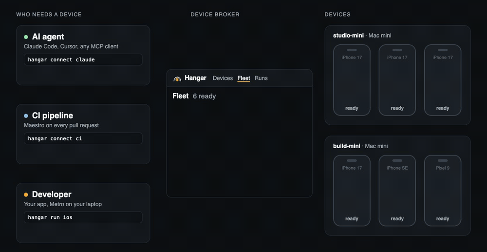

<p align="center"></p>

Hangar is a free, open source device broker. It runs iOS simulators and Android emulators on
your Macs and lends them to your developers, your CI and your AI agents. When one of them is done,
Hangar wipes the device and puts it back. You can use it instead of Expo Simulators and EAS
Maestro jobs, with or without the rest of EAS. Physical phones are on the [roadmap](ROADMAP.md).

## What you can use it for

- **Develop on a device you don't have.** `hangar run ios` builds your app, borrows a simulator
  and connects it to Metro on your laptop. Fast Refresh, React DevTools and the debugger work as
  they do locally.
- **Test every pull request.** The GitHub Action splits your Maestro flows over fresh devices,
  runs a failed flow once more, and writes one JUnit report with a video of each failure.
  XCUITest and Espresso runs are built but haven't run against a real test target yet.
- **Let AI agents check their own work.** Claude Code, Cursor or any MCP client can take a device,
  tap through your app and read what is on the screen.
- **Try a build by hand.** Open a device in the browser, click and type on it, and send a
  recording of the bug as a link.

## Start

On the Mac that will hold the devices, such as a Mac mini in the office:

```bash
git clone https://github.com/mariusud/hangar && cd hangar
pnpm install && npm install -g ./packages/hangar
hangar up
```

Open the link it prints to see the devices. Invite your team from the console's People page.

<p align="center"></p>

## Connect

| To use devices from | Run |
|---|---|
| Claude Code | `hangar connect claude` |
| Cursor or another MCP client | `hangar connect cursor` |
| Maestro in CI | `hangar connect ci`, then paste the two secrets and the step it prints |
| Your React Native app, with Fast Refresh | `hangar run ios` or `hangar run android` in your app's folder |
| A test by hand | the console: Use one, then Record for a bug link |
| Your own code | `const device = await hangar.lease()` ([client](docs/guides/agents.md#rest-for-agents-with-their-own-tools)) |

These work on the Hangar Mac as they are. On your laptop, install the CLI the same way and run
`hangar login http://your-mac.local:7420` once. Your CI also has to reach the Mac: put the runner
on the same network, or add a VPN step such as
[Tailscale's GitHub Action](https://github.com/tailscale/github-action) to the job.

Each guide has the details: [agents](docs/guides/agents.md),
[GitHub Actions](docs/guides/github-actions.md), [your app](docs/guides/expo.md),
[recordings](docs/guides/recordings.md), [Android](docs/guides/android.md),
[XCUITest](docs/guides/xcuitest.md).

## Why Hangar

- **Free and open source.** Apache-2.0. You need no account, Hangar sends no telemetry, and it
  works offline.
- **One pool for everyone.** Your developers, CI and agents draw from the same devices, and the
  Fleet page shows who has which one and what they are doing on it.
- **A clean device every time.** Hangar deletes each device after use and clones a fresh one, so
  a test can't inherit a login or a half-finished state from the one before.
- **Builds stay with you.** Your unreleased app and your test accounts stay on your own network.
- **Fast.** On one Mac we measured 52 frames a second in the browser and 87 ms from saving a file
  to seeing the change on the device ([numbers](docs/numbers.md)).

Pick a hosted service if nobody on your team wants to look after a Mac, or if your agents run in
the cloud and can't reach your network.

| | Hangar | Simlock | Argent | Expo Simulators |
|---|---|---|---|---|
| Made for | People, CI and agents | Coding agents | One agent, locally | Agents, hosted |
| Use a device in the browser | Yes | Yes, off by default | Not documented | Yes |
| Sharded CI runs with JUnit | Yes | Not documented | Not documented | Not documented |
| Fast Refresh on a leased device | Yes | Metro tunnel only | Local only | Yes |
| Physical phones | Not yet | Yes | Yes | No |
| Runs on | Your Macs | Your machines | Your machine | Expo's servers |

[Full comparison and sources](docs/comparison.md).

## Status

Early, and not on npm yet. It runs on one Mac; more Macs join with `hangar join`, tested on one
machine so far. A leased iOS app runs as a process on the Mac, so use separate Macs for teams that
do not trust each other's code. Read Apple's macOS license for what running simulators for your
own team allows.

[Features](docs/features.md) · [Measured speed](docs/numbers.md) ·
[More Macs and Docker](docs/guides/more-macs.md) · [Single sign-on](docs/guides/sso.md) ·
[Design](docs/design.md) · [Roadmap](ROADMAP.md) · [Contributing](CONTRIBUTING.md) ·
[Security](SECURITY.md) · Apache-2.0

Hangar is not affiliated with Expo.
