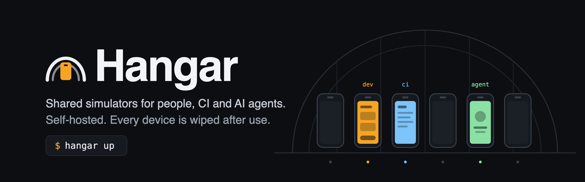

<p align="center"></p>

A React Native team needs clean iOS simulators all day: on each developer's laptop, in every CI
job, and now for every AI agent. Today each laptop boots its own, CI runners boot theirs from
scratch, and parallel agents fight over whichever simulator is open. Hosted device farms fix
that for a fee per minute.

Hangar turns one or more Macs you already have, such as a Mac mini in the office, into a pool of
simulators and emulators that everyone shares. Each person, CI job or agent asks for a device,
gets one nobody else touches, and gives it back. Hangar wipes it and hands out a fresh one next
time.

```bash
git clone https://github.com/mariusud/hangar && cd hangar
pnpm install && npm install -g ./packages/hangar
hangar up
```

`hangar up` checks the Mac, boots a few simulators and prints a sign-in link. Open it, and the
console shows the devices. Invite your team from the People page.

<p align="center"></p>

## Connect what needs a device

Everything below talks to the same Hangar. Make a token for each one on the console's Connect
page, so you can revoke one without breaking the others.

### Maestro tests in CI

Your pipeline uploads the app, Hangar splits the flows over fresh devices, retries a failed flow
once, and returns one JUnit report with a video of every failure.

1. On the Connect page, make a token with **Can upload apps** ticked. Save it as the
   `HANGAR_TOKEN` secret, and the Mac's address as `HANGAR_URL`.
2. Build a Release simulator app, so the JavaScript is inside it.
3. Add the step:

```yaml
- uses: mariusud/hangar@main
  with:
    url: ${{ secrets.HANGAR_URL }}
    token: ${{ secrets.HANGAR_TOKEN }}
    app: build/Build/Products/Release-iphonesimulator/MyApp.app
    flows: .maestro
    shards: 3
```

Any other CI runs the same thing with `hangar run maestro .maestro --app MyApp.app --shards 3`.
The CI runner has to reach the Mac, on the same network or through a VPN such as Tailscale.
XCUITest and Espresso work the same way. [Full guide](docs/guides/github-actions.md).

### An AI agent

Claude Code, Cursor, Codex or any MCP client gets its own device for the session. The Connect
page prints the line for your agent, with the token filled in:

```bash
claude mcp add --transport http hangar http://studio-mini.local:7420/mcp \
  --header "Authorization: Bearer <token>"
```

Then ask it something like "lease an iPhone from hangar, open the app and check that sign-in
works". The tools have the same names as mobile-mcp's, so prompts and agents written for
mobile-mcp work as they are. The agent says what it is doing when it leases, and the Fleet page
shows it. [Full guide](docs/guides/agents.md).

### Your app, with Fast Refresh

From your app's folder on your own laptop:

```bash
hangar login http://studio-mini.local:7420
hangar run ios          # or: hangar run android
```

Hangar builds the app (or takes `--app`), leases a simulator, connects it to Metro on your
laptop and opens the live screen. Save a file and the leased device updates. React Native
DevTools works through the same connection. [Full guide](docs/guides/expo.md).

### Testing by hand

In the console, pick a device and press Use one. Install a build, use it with the mouse and
keyboard, and press Record. Stopping gives one link with the video, every tap and the app log,
for the bug report. [Full guide](docs/guides/recordings.md).

### Your own scripts

```ts
import { Hangar } from 'hangar';

const hangar = await Hangar.fromEnv(); // HANGAR_URL and HANGAR_TOKEN
await using device = await hangar.lease({ model: 'iPhone 17' });
await device.launch('com.example.app');
await device.tap({ label: 'Sign in' });
```

The same calls are a REST API. [Agents and the REST API](docs/guides/agents.md#rest-for-agents-with-their-own-tools).

## How it compares

| | Hangar | Simlock | Argent | Expo Simulators | Hosted farms |
|---|---|---|---|---|---|
| What it is | A shared pool for a team | A device pool for coding agents | One agent driving local devices | Hosted simulators for agents | Rented devices |
| Runs on | Your Macs | Your Macs and Linux machines | Your own computer | Expo's servers | Their servers |
| People use devices in the browser | Yes, with touch and keyboard | Watch only | Not documented | Yes | Yes |
| CI test runs, sharded, with JUnit | Maestro, XCUITest, Espresso | Not documented | Not documented | Not documented | Yes |
| AI agents over MCP | Yes | Yes | Yes | Through other tools | Some |
| Fast Refresh on a remote device | Yes | Metro tunnel only | Local only | Yes | No |
| Physical phones | Not yet | Yes | Yes | No | Yes |
| Cost | Free, Apache-2.0 | Free, MIT | Free, with proprietary helpers | Invite-only preview | Per minute |

Pick Simlock if your only users are coding agents, or you need physical phones today. Pick
Argent for one agent working on your own machine; it also covers TVs and profiling. Hangar is
for when the same devices serve people, CI and agents at once.
[Details and sources](docs/comparison.md).

## Speed

On an M4 Pro, through the real broker and agent:

| | |
|---|---|
| Live screen | 52 fps, H.264, about 500 KB/s |
| Swipe to first changed frame | 109 ms p50, 197 ms p95 |
| Save a file to Fast Refresh on the leased device | 87 ms p50 |
| Screenshot, element tree | 39 ms, 3 to 5 ms |

[All measurements](docs/numbers.md).

## Status

Early, and not on npm yet. Everything above runs on one Mac. More Macs join with `hangar join`,
which so far is only tested on one machine. A leased iOS app runs as a process on the Mac, so use
separate Macs for teams that do not trust each other's code. Hangar runs on hardware you own,
for your own development and testing; read Apple's macOS license for what that allows.

More: [all features](docs/features.md), [more Macs and Docker](docs/guides/more-macs.md),
[single sign-on](docs/guides/sso.md), [device images](docs/guides/device-images.md),
[design](docs/design.md), [brand](docs/brand.md), [roadmap](ROADMAP.md).

Apache-2.0. Hangar sends no telemetry and needs no internet access.
[Contributing](CONTRIBUTING.md) · [Security](SECURITY.md)
