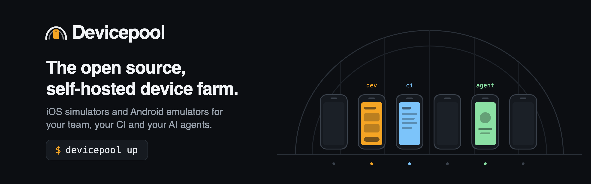

# Devicepool

Devicepool is an open source, self-hosted device farm for iOS simulators and Android emulators, for your team, your CI and your AI agents.

It runs the devices on your own Macs and lends them out one at a time. When a lease ends,
Devicepool wipes the device and puts it back in the pool. It is free under Apache-2.0, needs no
account and sends no telemetry. Physical phones are on the roadmap.



## Start

On the Mac that will hold the devices, such as a Mac mini in the office:

```bash
git clone https://github.com/mariusud/devicepool && cd devicepool
pnpm install && npm install -g ./packages/devicepool
devicepool up
```

Open the link it prints to see the devices. Devicepool is early and not on npm yet.

## What it does

- [Features](features.md): everything Devicepool does today.
- [Measured speed](numbers.md): frame rate, input delay and Fast Refresh time on one Mac.
- [How Devicepool compares](comparison.md): Simlock, Argent, Tapflow and Expo Simulators side by
  side, and hosted prices.
- [Design](design.md): how the broker, the agents and the leases work.
- [Decisions](https://github.com/mariusud/devicepool/tree/main/docs/decisions): why it is built
  this way.
- [Apple's license terms](licensing.md): what to read before you lend simulators to others.
- [Brand](brand.md): the name, the mark, colors and wording.

## Guides

| To | Read |
|---|---|
| Connect Claude Code, Codex, Cursor or another MCP client | [AI agents](guides/agents.md) |
| Run your Expo or React Native app with Fast Refresh | [Your app](guides/expo.md) |
| Run Maestro flows on several devices | [Maestro flows](guides/maestro.md) |
| Test every pull request | [GitHub Actions](guides/github-actions.md) |
| Run XCUITest | [XCUITest](guides/xcuitest.md) |
| Add Android emulators, run Espresso | [Android](guides/android.md) |
| Record a bug as a link | [Recordings](guides/recordings.md) |
| Keep simulators ready with your app installed | [Device images](guides/device-images.md) |
| Show a live device in your own page | [Embed a screen](guides/embed-screen.md) |
| Book devices for a nightly agent run | [Night QA](guides/night-qa.md) |
| Add Macs, or run the broker in Docker or Kubernetes | [More Macs](guides/more-macs.md) |
| Sign in with OpenID Connect | [Single sign-on](guides/sso.md) |
| Start Devicepool at login or at boot | [Unattended](guides/unattended.md) |
| Know what a leased app can reach on the Mac | [Isolation](guides/isolation.md) |

## Alternatives to hosted device clouds

Devicepool can replace a hosted device cloud for the work that simulators and emulators can do.
Each page says what Devicepool does instead, what it does not do, and when the hosted service is
the better choice.

- [Alternative to Maestro Cloud](alternatives/maestro-cloud.md)
- [Alternative to AWS Device Farm](alternatives/aws-device-farm.md)
- [Alternative to BrowserStack App Live](alternatives/browserstack-app-live.md)
- [Alternative to Appetize](alternatives/appetize.md)
- [Alternative to Expo Simulators](alternatives/expo-simulators.md)
- [All alternatives](alternatives/index.md)

## Source

The code, the roadmap and the issue tracker are at
[github.com/mariusud/devicepool](https://github.com/mariusud/devicepool).

Devicepool is not affiliated with Expo.
